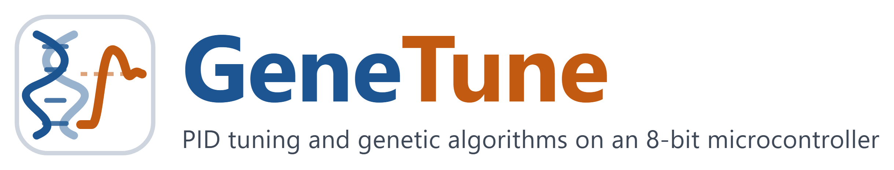

# GeneTune-PID

**Online:** https://thalitanazare.github.io/GeneTune-PID/

Laboratory interface for teaching PID tuning and genetic algorithms on the ball-in-tube rig (Arduino Nano, project firmware).

## Start
Double-click `GeneTune.bat` (needs Python; opens http://localhost:8765 in the default browser). Use Chrome or Edge for the live mode.
Opening `index.html` directly also works for the five replay stages.

https://github.com/user-attachments/assets/05cee45d-911c-420d-9b53-3368ac2b40cc

## Replay stages (1-5)
Measured reference data set (`data.js`, generated by `tools/build_data.py` from the measured logs of the research project). Only the Stage 2 sandbox simulates the identified model.

## Live rig
1. Close any other program using the COM port (PlatformIO monitor, Python scripts).
2. Click "Connect to Arduino" and choose the Nano's COM port. The page waits for READY, sends START and MODE:BALL.
3. Choose an experiment and press Start. STOP turns the fan off at any time.
   - Quick test: one closed-loop step with the given gains (about 40 s).
   - Relay test: Ku, Pu and ZN gains (about 45 s); results are copied into Stage 1.
   - On-chip GA tuning: TUNE on the Nano, streamed live (about 25 min for Np=8, G=5); "Open in Stage 4 replay" adds it as a new run.
   - Supervised operation: AUTO with setpoint change and retuning (about 30 min).
4. "Download CSV" saves rows and events in the same format as `data/embedded/*.csv`.
"Use firmware emulator" runs the same protocol against a simulated board (for checking the workflow without the rig; `#speed=N` in the URL sets the speed).

## Learning report and questionnaire

After a live experiment finishes, GeneTune automatically adds a learning report below the result. The report explains the observed metrics, states whether the source was the rig or the firmware emulator, and poses questions tied to the result. Objective answers receive immediate feedback; written explanations are saved for an educator to discuss. Stage 4 also generates a report for the selected measured replay run. Selecting another replay run refreshes the report.

The **Download report JSON** button saves configuration, metrics, explanation, questions, student answers, feedback and evidence. For a live run it includes the last episode trajectory and protocol events. **Download printable report** saves a standalone HTML document that can be opened in a browser and printed. Both files are generated locally; there is no account or network service.

For a useful comparison on the physical rig, first run a ZN quick test at 15 cm, then test alternative gains in the same session. The report compares their ITAE with that one same-session ZN trial. Without such a baseline, it labels the session-A ZN mean from the reference data set as context from another session. A ?10% band is used only to teach interpretation of a measured cost; it is not a pass/fail criterion for controller quality. The report distinguishes the selected stored GA score from its independent confirmation and explains the limit of early stopping under noise.

To have a physical run analysed later, download and send the report JSON. Also keep the existing **Download CSV (rows + events)** files if analysis of the entire trajectory or every tuning trial is needed. The firmware emulator exercises the workflow and uses a model; its results are labelled as emulator data.

The current interface also labels GA tuning and supervisory control as separate live modes, explains the Stage-2 model-to-rig discrepancy, and states the realised-trial limit of Stage-4 early stopping. These changes followed the formative pilot; no new student or agent evaluation of them is claimed.

## Repository layout
- `index.html`, `data.js`, `report.js`: the interface (served by GitHub Pages).
- `GeneTune.bat`: local launcher for the live mode on Windows.
- `assets/`: logo files.
- `tools/`: scripts that generate `data.js` and convert serial logs for replay.
- `examples/`: a recorded live log that can be opened with "Open recorded log…".
